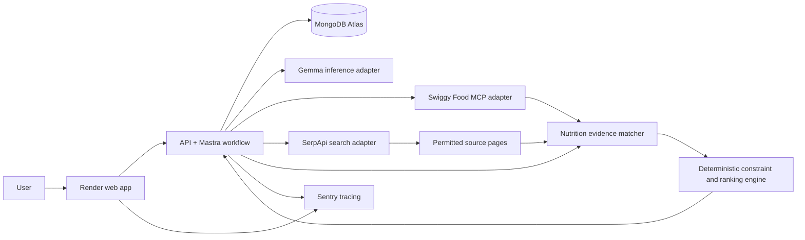
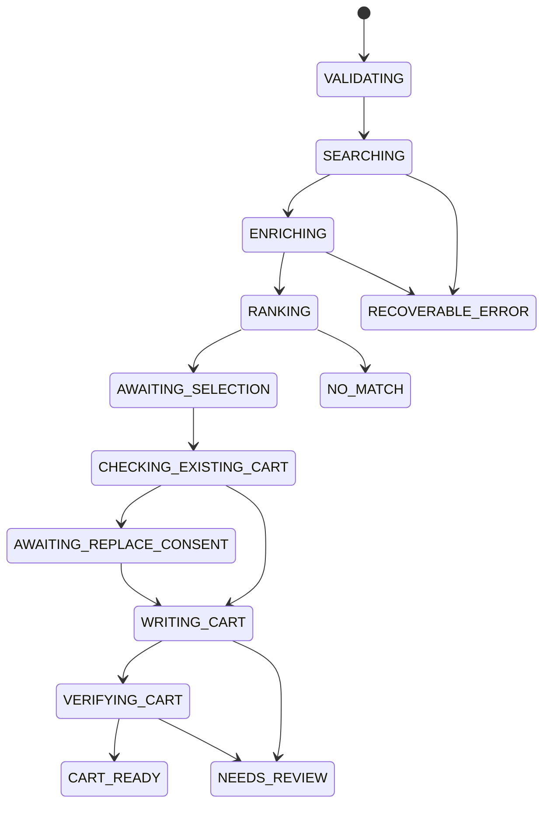

# Meal agent architecture — Hacktoberfest Week 3

**Working name:** MealPilot

**Product promise:** Give the agent a delivery location, an all-in budget, dietary rules, and remaining meal or daily macro targets. It searches real available food, explains the closest matches with evidence, and prepares a cart after the user chooses an option. The user controls checkout.

**Challenge window:** October 19–25, 2026 PDT. The new project, repository, working demo, code link, and English DEV write-up must be completed within that window. Source: [challenge rules](https://dev.to/page/hacktoberfest-week3-2026-10-19-contest-rules).

## 1. Product contract

The system should be able to answer: “I have ₹350 including fees, want vegetarian dinner, and have about 35 g protein and 700 kcal left. What can I order?” It should return a few **available** options, explain their source-backed nutrition and budget tradeoffs, and prepare the selected cart. It must say when no option satisfies all hard constraints.

The first release covers one user-selected Swiggy delivery address, one restaurant per cart, and at most two menu items per candidate combination. The user supplies macro goals. The system does not infer a medical or dietary prescription. The ordering integration is Swiggy Food MCP; SerpApi expands *nutrition evidence and discovery leads*, while Swiggy remains the authority for deliverability, menu identity, item availability, customizations, and cart price.

| Invariant | Implementation |
| --- | --- |
| All-in budget | Compare against `get_food_cart`'s live `to_pay`, including fees and discounts. Menu price is only an early estimate. |
| Macro provenance | Every displayed number has an exact item/variant/portion match, source URL, retrieval time, and source type. Otherwise mark it estimated or unknown. |
| Dietary rules | Only explicit platform or reliable source data can satisfy a hard dietary constraint; unknown information cannot. |
| User control | Show candidates first. Mutate the cart only after the user chooses one and selects **Prepare cart**. Never place an order automatically. |
| Existing cart | Read before writing. If the cart contains different items or another restaurant, explain what would change and obtain an explicit replace action. |
| Uncertain mutation | If a write times out, read the live cart before deciding whether it succeeded. Do not blindly repeat the write. |
| Freshness | Refresh menu details and cart before the final confirmation. A saved search result is never treated as a live quote. |

Swiggy documents a `search_menu` → `update_food_cart` → `get_food_cart` journey, including item identifiers, variant formats, valid add-ons, and a user selection before adding. [Search menu](https://mcp.swiggy.com/builders/docs/reference/food/search_menu/), [update cart](https://mcp.swiggy.com/builders/docs/reference/food/update_food_cart/), [read cart](https://mcp.swiggy.com/builders/docs/reference/food/get_food_cart/).

## 2. System map



The browser sends a request and displays progress, evidence, alternatives, and the final cart. It never holds Swiggy, SerpApi, Gemma, MongoDB, or Sentry credentials. The API validates requests and owns job state. Mastra coordinates bounded tool calls and human review. Gemma handles ambiguous language, query generation, extracting claims from source text, and clear explanations. Code handles money, constraints, source matching, ranking, and cart safety. Mastra supports typed tools and MCP connections. [Mastra MCP documentation](https://mastra.ai/docs/agents/mcp-guide).

**Inference deployment:** run the same open-weight Gemma variant through Ollama locally during development. The deployed app uses a configured endpoint serving that Gemma variant; choose its host only after measuring latency, memory, and cost. Render hosts the app and agent, not an assumed free GPU. The app can have a recorded demo if live model hosting is unavailable. Google documents Gemma with Ollama, including quantized local variants. [Gemma/Ollama guide](https://ai.google.dev/gemma/docs/integrations/ollama).

## 3. Agent and tool boundaries

Use **one orchestrated agent** rather than a swarm of agents. Its reasoning is limited by typed tools and explicit workflow steps:

1. **Understand request:** Gemma converts free text into a validated `MealRequest`. Ask for only essential missing information, such as delivery location or whether the budget includes fees; default budget semantics are always all-in.
2. **Find candidates:** search Swiggy for diverse dish terms and nearby available restaurants. Bound queries, pagination, candidate count, total time, and tokens. De-duplicate by stable restaurant and menu item IDs.
3. **Enrich evidence:** inspect each promising menu item and exact customization. If nutrition is absent, SerpApi searches for the restaurant's own page or another attributable source. Fetch permitted source pages and extract claims; a search result snippet is only a lead. Match restaurant, item, portion, and variant before attaching any macro value.
4. **Evaluate:** deterministic code rejects hard-rule failures, ranks qualified options, and records the reason for every rejection. It produces a Pareto-style fallback set when no exact fit exists.
5. **Explain and wait:** Gemma writes a short recommendation from the structured evaluation, without adding facts. The UI shows source links, uncertainty, and an explicit **Prepare cart** action.
6. **Prepare and audit cart:** re-read current cart, revalidate selected menu IDs, apply the exact supported variant/add-on format, call `update_food_cart`, then immediately call `get_food_cart`. The final payable total is checked against the budget. Return an actual prepared-cart state only after the read-back confirms contents.

The model is **not** given a general-purpose `place_food_order` tool. A server-side allowlist exposes only the Swiggy calls needed for discovery and cart preparation. The user completes checkout in the Swiggy experience.

### Agent design concepts used deliberately

- **Bounded planning:** Gemma proposes several dish search terms from the user's goals; the workflow caps searches, candidate count, time, and model calls. The plan is observable in the job record.
- **Parallel discovery, serial decisions:** Independent Swiggy searches and nutrition-source searches can run concurrently. Cart reads and writes run sequentially under a per-user lock.
- **Tool-output grounding:** Every recommendation names the menu item ID, live platform record, and nutrition claim IDs it used. External webpages are data, never new instructions for the agent.
- **Deterministic critic:** A separate validator recomputes hard constraints and rejects unsupported claims before any explanation reaches the user. The explanatory model cannot override the validator.
- **Bounded replanning:** If a search returns no useful results, expand to a small set of synonyms or nearby categories. If nutrition remains unknown, stop searching after the budgeted attempts and report uncertainty.
- **Human review as workflow state:** Selection, replacing an existing cart, and checkout are distinct actions. Mastra pauses at selection; the next step resumes from persisted candidate IDs rather than regenerating recommendations.
- **Memory with scope:** Saved preferences can influence ranking; a new request's hard limits always take precedence. Historical orders are signals of taste, never evidence of current stock, prices, or nutrition.

### Why SerpApi is useful here

SerpApi's Google Search API supports search queries, location, country, and language parameters. We use it to find **fresh evidence** such as an exact restaurant menu PDF or nutrition page, and perhaps discover candidate restaurants for later confirmation through Swiggy. We do **not** use a web result to claim that an item is deliverable or that its web price equals the live Swiggy cart price. [SerpApi API](https://serpapi.com/search-api).

For each search query, retain the query, result URL, discovery timestamp, and whether the source was actually fetched. Search requests use a city-level location rather than a precise delivery address where possible. Whitelist or review source domains; respect access rules; never treat arbitrary page text as instructions to the agent.

## 4. Nutrition evidence contract

Swiggy states that restaurant partners may voluntarily provide ingredient, allergen, and nutrition information, so coverage varies. Its published `search_menu` schema does not promise macro fields. [Swiggy disclosure](https://www.swiggy.com/corporate/wp-content/uploads/2025/07/Swiggy-AR-FY25_BRSR_29.07.25.pdf), [search schema](https://mcp.swiggy.com/builders/docs/reference/food/search_menu/).

```text
NutritionClaim {
  restaurant_id, menu_item_id, item_name, variant_id?, portion_label?,
  nutrients: { kcal?, protein_g?, carbs_g?, fat_g? },
  source_type: "platform" | "restaurant" | "third_party" | "estimated",
  source_url?, retrieved_at, quote_or_field_path?,
  match_status: "exact" | "ambiguous" | "unmatched"
}
```

The UI uses **documented**, **estimated**, and **unknown** labels. “Documented” means a source states the value; it does not claim laboratory verification. Strict macro filtering accepts only exact matched, documented claims. Estimated claims may inform soft ranking but carry an explicit uncertainty range if there is a defensible method. If no such method exists, show unknown. Allergens are never inferred safe from an absent mention.

Add-ons and sizes may change nutrition. A claim for a base dish does not transfer to a different variant unless the source explicitly covers it. When claims conflict, retain both sources and downgrade to ambiguous; the agent cannot silently average them. Store a short supporting excerpt or field path and URL, not entire third-party pages.

## 5. Request, candidate, and workflow state

```text
MealRequest {
  user_id, address_ref, currency: "INR", budget_all_in_paise,
  meal_slot, diet: { veg?, excluded_ingredients?, allergens? },
  targets: { min_protein_g?, max_kcal?, carb_range_g?, fat_range_g? },
  preferences: { cuisines?, disliked_items?, max_eta_min? },
  hard_rules: string[], soft_preferences: string[]
}

Candidate {
  platform: "swiggy", restaurant_id, menu_item_ids[], exact_variant_ids[],
  quantity[], menu_snapshot_at, estimated_item_total_paise,
  nutrition_claim_ids[], availability_state, rejection_reasons[],
  score_components: { preference, nutrition_fit, price_margin, eta, uncertainty }
}

CartAudit {
  job_id, selected_candidate_id, consent_at, before_cart_hash,
  after_cart_hash?, live_to_pay_paise?, live_items?, status,
  mismatch_reason?, checked_at?
}
```

MongoDB Atlas collections: `users` (minimal profile), `preferences`, `meal_jobs` (workflow state), `candidates`, `nutrition_claims`, `cart_audits`, and `evaluation_cases`. Separate credentials from these collections. Index by user/job and restaurant/item. Cache search snapshots with explicit expiry; long-lived nutrition claims retain their retrieval timestamp and require rechecking before reuse. Persist stage inputs and outcomes so a client refresh does not lose progress. MongoDB supports time-to-live indexes for expiring cache records. [MongoDB TTL documentation](https://www.mongodb.com/docs/manual/core/index-ttl/).

The browser-facing API has four operations: create a job from a typed request, read job progress/results, select a candidate, and prepare the selected cart. Each mutation carries the current job version and a client-generated request ID so stale or duplicate browser submissions cannot advance our workflow twice. Swiggy credentials stay in the server-side OAuth session; the public job response exposes only safe identifiers and display data.



`NO_MATCH` is a valid result with closest alternatives, not a system error. `NEEDS_REVIEW` means the live cart, total, or mutation outcome cannot be safely confirmed. A repeated request uses a client-generated idempotency key for **our API**. Since Swiggy's public tool documentation does not establish mutation idempotency, recovery from a timeout must read cart state before any further write. A per-user cart lock prevents two active jobs in this app from racing; the user may still edit their Swiggy cart externally, so every cart operation re-reads the live state.

## 6. Ranking and budget logic

Apply hard filters first: deliverability, stock, dietary rule, exact documented nutrition for strict macro goals, and known upper bounds where possible. Rank survivors with a transparent score: closeness to target, budget margin, user preference, delivery time, and evidence quality. Keep the component values in the response so the explanation can cite them. A model never invents the score.

Before cart preparation, price is provisional. Rather than building and replacing several real carts to quote every candidate, display menu-based estimates and disclose that fees are pending. Build **one chosen cart**. If its live `to_pay` breaks the budget, mark it over budget and offer the next option for a new user selection. Never claim that a candidate met the all-in budget from menu price alone.

For impossible requests, identify the smallest useful relaxation: for example “₹38 over budget with documented protein,” “10 g below protein within budget,” or “nutrition unknown.” The app should show these as alternatives, not as exact matches.

## 7. Reliability, privacy, and observation

| Failure | Behavior |
| --- | --- |
| Swiggy login or production access unavailable | Stop at a clearly labelled staging or replay demo; do not depict a mock cart as live. |
| Swiggy search empty | Try a bounded synonym set, then report no available options for the chosen address. |
| SerpApi unavailable | Continue with platform data and disclose reduced nutrition coverage. |
| Source page blocked or mismatched | Discard its macro claims and continue with unknown nutrition. |
| Model fails or emits invalid JSON | Retry a bounded number of times; fall back to a simple form and deterministic output. |
| Cart changes or item becomes unavailable | Read live state, stop the write, and ask the user to choose again. |
| Cart write times out | Read live cart and reconcile; never blind-retry a potentially completed mutation. |
| Final payable exceeds budget | Report the exact amount and offer another candidate. |

Sentry spans should follow `request → parse → Swiggy search → SerpApi search → source match → rank → cart write → cart read`. Record latency, errors, model and tool usage, candidate counts, evidence coverage, and cart audit result. Attach a job ID and hashed user ID. Do not send addresses, OAuth tokens, full prompts containing personal details, or full source pages into traces. The DEV article should include a real trace and what it helped fix. [Challenge Sentry category](https://dev.to/challenges/hacktoberfest-week3-2026-10-19).

Swiggy access uses its OAuth flow, with secrets server-side. Development/staging is described as self-serve; production access requires a reviewed application. Submit that application as soon as the first staging flow works. [Swiggy developer quickstart](https://mcp.swiggy.com/builders/docs/start/developer/).

## 8. Evaluation plan and winning demo

Create a small, documented evaluation set of real or replayed menu cases and manually checked expected results. Keep the raw sources, expected output, observed output, and failure notes. Suggested cases:

1. Valid vegetarian, documented-protein match under the **final** budget.
2. Attractive menu price that exceeds budget after delivery and taxes.
3. Similar dish name at a different restaurant; nutrition must not transfer.
4. Base dish with an add-on or size change; nutrition must be downgraded if the source does not cover it.
5. No exact match; show honest relaxations.
6. Source disagreement or missing serving size; mark ambiguous.
7. Menu item goes out of stock before cart write.
8. Cart write timeout; reconcile by reading live state.
9. Existing cart from another restaurant; require a replace action.
10. User revises budget or diet; invalidate stale candidates.

Report measurable results: constraint parsing accuracy, unsupported macro-claim rate, exact-source match precision, final budget compliance for successfully prepared carts, cart audit success, median and p95 latency, and the percentage of candidates with documented nutrition. Measure a human baseline on the same tasks: time spent finding and preparing one acceptable meal. Avoid claiming a large gain from a tiny sample; publish sample size and failures.

Demo arc: user enters a realistic request → agent compares live options → shows evidence and an uncertainty label → user selects a dish → cart is prepared and read back with final total. A second short clip shows a deliberate failure or impossible request handled cleanly. The narrative should explain why the open-weight model matters: the reasoning layer can run under the builder's control and be tested against the same cases. It should also say what information still leaves the system for Swiggy, SerpApi, hosting, and tracing.

## 9. Partner category evidence

| Category | Substantial use | Submission evidence |
| --- | --- | --- |
| Gemma | Main language reasoning on an open-weight model | Exact model/runtime, prompt and evaluation cases, latency. |
| Mastra | Typed tools and the real multi-step workflow | Workflow diagram, run trace, human selection step. |
| Sentry Agent Tracing | Observe actual model and tool activity | Screenshot/trace, measured latency/usage, bug diagnosis. |
| Render | Serve the functioning app and API | Live URL, deployment explanation. |
| MongoDB Atlas | Persist preferences, evidence, jobs, and cart audits | Schema and a returning-user or recovered-job demo. |
| Entire | Capture meaningful development sessions | Links to selected sessions and the decision/fix they explain. |
| SerpApi | Live search that improves nutrition-source coverage | Before/after coverage measurement and exact result URLs. |
| .tech domain | Host the real deployed site on the claimed domain | Working link in the DEV post. |

The category list and criteria come from the [Week 3 challenge page](https://dev.to/challenges/hacktoberfest-week3-2026-10-19). Eight categories are targeted; enter only those demonstrably working. One project can win at most one prize. The DEV article matters most, so reserve time for the demo, evaluation, and writing.

## 10. Delivery order and gates

1. **Integration gate:** authenticate Swiggy staging, search an address, obtain real menu IDs, add one chosen item, and read the cart back. Inspect whether macro data appears in actual responses. Record what works. Apply for production access early.
2. **Core path:** validate a typed meal request; search, filter, rank, show evidence, choose, prepare one cart, audit final payable.
3. **Open-model gate:** run Gemma on representative prompts and measure parsing and explanation errors. Use the same model family in the demo.
4. **Coverage gate:** add SerpApi only after baseline nutrition coverage is measured. Require exact entity matching and source links. Measure its incremental gain.
5. **Reliability gate:** persist job state, add safe cart reconciliation, Sentry spans, and the failure cases above.
6. **Presentation gate:** deploy on Render, connect the .tech domain, capture Entire sessions, record the demo, and write the DEV post before the deadline.

**Architecture decisions still requiring validation in the build:** Swiggy production approval timing; real nutrition coverage for the chosen city and restaurant set; Gemma model/runtime performance on available hardware; SerpApi's incremental coverage after exact matching; and whether the deployed Gemma endpoint can meet acceptable response time and cost. These are test gates, not assumptions to conceal in the submission.
