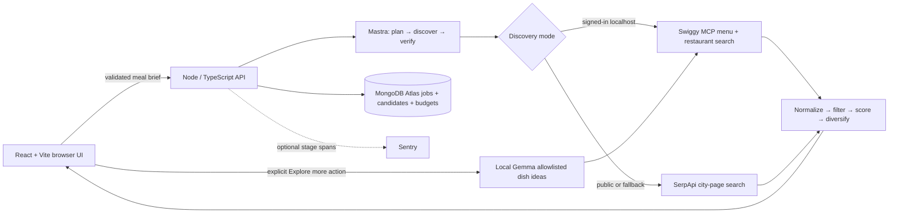
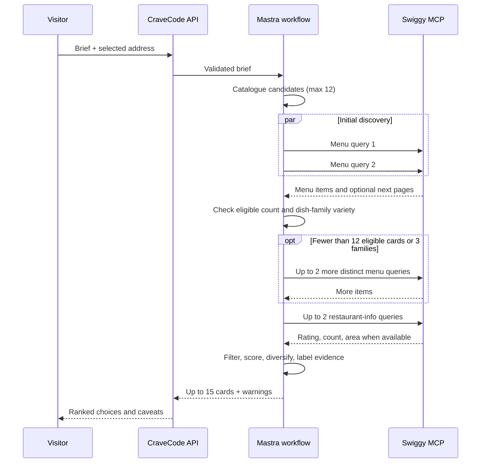

# CraveCode

**Food discovery against your goals, with evidence about what is still unknown.** Enter a meal, diet, protein minimum, calorie ceiling, budget, and optional cuisine or dish. The signed-in local demo searches live Swiggy menus near a saved delivery address and returns up to 15 varied choices. The [public Render preview](https://cravecode.onrender.com/) explores city-specific food pages; it cannot yet sign in to Swiggy or verify those pages as live menu items.

CraveCode is a Hacktoberfest Week 3 project in **Phase 2: discovery and explanation**. Search and ranking work. Exact restaurant nutrition, final delivery total, and cart read-back do not. The app does not place an order.


[Mobile view](./docs/cravecode-mobile.png) · [Meal brief](./docs/cravecode-brief.png) · [Four-phase roadmap](./FOUR_PHASE_ROADMAP.md)

## Two honest demo modes

| | Signed-in local demo | Public Render preview |
| --- | --- | --- |
| Open | `http://localhost:8787` after setup | [cravecode.onrender.com](https://cravecode.onrender.com/) |
| Discovery | Swiggy MCP menu searches for a selected saved address | One SerpApi Google query for Swiggy city pages per uncached search |
| Result | Up to 15 ranked **live menu items** | Up to 15 filtered **web leads**; open the source page to investigate |
| Evidence | Menu price, stock/diet flags, limited restaurant rating context when provided | No verified menu price, stock, diet, delivery, review, or nutrition |
| Nutrition | Broad dish-level guesses for supported names; otherwise unknown | Unknown |
| Extra ideas | Optional local Gemma action | Unavailable |
| Limit | No five-search demo cap on connected Swiggy searches | Five search submissions per browser session, plus shared SerpApi guards |

The hosted preview is useful for viewing the product and exploring leads. It is **not** a live Swiggy-menu mirror of the local demo. A good rating is customer feedback, not a food-safety certification. Menu price is not the all-in price: taxes, fees, discounts, and the final payable amount need cart verification.

## The experience

The page moves from a white hero with eight supplied food illustrations, through a dark meal-brief form, to a white results area. Motion is decorative; the form and results remain usable with reduced motion. A dish name is optional: leaving it blank lets the planner explore several food families. The form also supports diet, meal slot, goal, protein, calories, total budget, cuisine, exclusions, and a better-reviewed restaurant preference. Cards distinguish live menu evidence from public web leads and show cautions alongside suggestions.

<!-- Add current results and mobile screenshots here before submission. Caption local Swiggy items and Render web leads separately. -->

## Architecture



The browser never receives server credentials for Swiggy, SerpApi, Atlas, or Gemma. The API validates input with Zod, then runs Mastra's **plan → discover → verify-evidence-labels** workflow. Swiggy and SerpApi are separate modes under one versioned result contract with explicit source labels. Atlas saves completed jobs and candidates when configured and holds demo/SerpApi budget counters. A failed optional result write adds a warning; on Render, an unavailable Atlas budget store stops paid SerpApi requests. Sentry stage spans run only with `SENTRY_DSN` and omit credentials, address IDs, and request text.



The restaurant lookup starts after the first menu batch and can overlap the extra menu batch. Each menu query may read one additional Swiggy page. Source deadlines prevent one slow query from holding the whole response; successful queries can still return useful cards.

## Local search algorithm

1. **Plan food families.** [`local-catalog.ts`](./src/server/local-catalog.ts) maps aliases to North Indian, South Indian, Italian, Chinese, Mexican, Thai, Gujarati, and general dish families. Goal, protein target, calorie ceiling, meal slot, diet, and cuisine determine candidate order. An explicit dish goes first and expands only through known aliases. An unfamiliar cuisine is searched directly and must appear in menu text.
2. **Search adaptively, within a bound.** Two terms run together. If fewer than 12 eligible cards or three dish families appear, the engine tries up to two more, preferring unseen families. Four menu queries is the initial-search maximum. That limits provider work **per search**; it is not the five-search public demo limit.
3. **Normalize evidence.** Keep stable item and restaurant IDs, menu price, stock/diet flags, and optional description/category. Obvious meat or egg names can provide a cautious non-vegetarian label when the provider flag is absent. Diet filters reject uncertain items where a requirement cannot be established.
4. **Apply hard filters.** Remove known out-of-stock or closed items, incompatible diet, named exclusions, unrelated explicit-dish/cuisine matches, and menu prices already above budget. Unknown price stays visible with a caution; a menu price below budget never proves the **all-in** budget fits.
5. **Rank and diversify.** Full phrase and recognized family matches beat incidental word matches. The score also considers request terms, stock, known menu price, broad dish estimate, and restaurant feedback. Review count tempers the influence of a high rating with little history. Duplicate names within a restaurant collapse; repetition penalties spread early picks across families, restaurants, and price bands. A second pass fills remaining slots up to 15.

The local nutrition ranges in [`nutrition-estimate.ts`](./src/server/nutrition-estimate.ts) are hand-authored, broad guesses for recognizable dish types, **not** restaurant-specific calories or protein. Unsupported or complex dishes remain unknown. A range overlapping the goal is only *possible*; no item is an exact macro match without a source matching restaurant, item, variant, and portion. See [NUTRITION_METHOD.md](./NUTRITION_METHOD.md).

**Explore more dishes with Gemma** is a separate, explicit action. A small local model chooses up to three new terms from a diet/goal-aware allowlist. Code checks its structured output and falls back to deterministic choices if needed, then searches Swiggy and reports how many genuinely new cards it found. Gemma never supplies nutrition numbers or hard eligibility. The first search works without a model endpoint.

## Public search and credit protection

Render builds up to four rule-based dish themes into **one** city-specific Google query with `OR`, sent through SerpApi. The server keeps HTTPS delivery-page URLs, checks city and term relevance, and removes duplicates and generic pages. The current query targets Swiggy city pages; an allowlist of other delivery hosts is defensive filtering, not proof of additional provider integrations.

Public and local fallback web discovery accept five submissions per browser session (a 24-hour server-side session, stored in Atlas when available). Identical queries can use a one-hour in-memory cache. Separately, server-side guards cap SerpApi calls at **five per UTC day and 100 per UTC month**. Browser cookies are not the hard spend ceiling; the shared guard is. The experimental nutrition-reference endpoint shares that credit guard and cannot verify exact menu nutrition. Connected local Swiggy searches and Gemma follow-ups never invoke SerpApi.

## Run locally

Requires **Node.js 24+** and npm. A Swiggy account is needed for live local menus; keep phone and OTP in your own browser. Ollama with `gemma3:270m` is optional for extra ideas. Atlas, SerpApi, and Sentry are optional for a signed-in local search.

```powershell
npm ci
Copy-Item .env.example .env
npm run build
npm start
```

Open **http://localhost:8787**, connect Swiggy, choose a saved address, and submit the brief. For live UI editing, run `npm run dev:api` and `npm run dev` in separate terminals, open `http://localhost:5173`, and set `PUBLIC_ORIGIN=http://localhost:5173` in `.env`. A cached public OAuth client ID and redirect are kept in ignored `.swiggy-oauth-registration.json`; user access tokens and sessions stay in server memory and are lost on restart.

| Variable | Purpose |
| --- | --- |
| `PORT` | API/built-site port; default `8787`. |
| `PUBLIC_ORIGIN` | Browser origin for redirects and request checks; use the Vite origin in dev mode. |
| `MONGODB_URI`, `MONGODB_DB` | Optional Atlas connection and database (`mealpilot` by default). |
| `SERPAPI_API_KEY` | Server-only public/fallback search key. |
| `GEMMA_API_URL`, `GEMMA_MODEL`, `GEMMA_API_KEY` | Optional Ollama-compatible endpoint/model/auth for extra dish ideas. |
| `SENTRY_DSN` | Optional server trace destination. |

Never commit `.env`, API keys, Atlas credentials, or account tokens. [`.env.example`](./.env.example) contains placeholders. The [Render blueprint](./render.yaml) defines a free Node service, its build/start commands, and a health check. Configure `SERPAPI_API_KEY` and `MONGODB_URI` in Render Environment, not in Git; allow the service's outbound network access in Atlas. Render derives its public origin from `RENDER_EXTERNAL_URL`. Its service can take time to wake after inactivity.

## Verify and measure

```powershell
npm run check
npm test
npm run build
npm run search:evaluate
```

`search:evaluate` compares the previous four-term search with the adaptive algorithm on three **synthetic** meal/menu fixtures: vegetarian protein, Italian, and Chinese. It reports relevant items retrieved, precision among the first five cards, dish families among the first 15, and menu-query count; it fails on relevance, variety, or the four-query bound. These fixtures are regression checks, **not live Swiggy accuracy measurements**. `npm run gemma:probe` and `npm run gemma:evaluate` require the model endpoint; the latter is an offline name-match proxy, not proof of live yield. Real evaluation needs reviewed, anonymized searches across addresses and cuisines, with no-match and latency cases.

Useful read-only checks: `GET /api/health` confirms the build; `GET /api/system` reports integration state and public-search allowance without exposing keys. `POST /api/meal-search` returns a versioned result. Other endpoints support brief validation, local OAuth/address flow, optional Gemma expansion, and an experimental cart probe. The probe is **not** in the user-facing flow because reliable write and read-back have not been demonstrated.

## Next proofs

| Priority | Work | Why |
| --- | --- | --- |
| Search quality | Evaluate live, anonymized Swiggy searches by cuisine, address, diet, relevance, variety, and latency; tune from observed misses. | Synthetic fixtures cannot show actual coverage. |
| Nutrition | Match restaurant-published data to exact restaurant, menu item, variant, and serving; record provenance and coverage/error. | Generic ranges cannot justify an exact macro claim. |
| Restaurant confidence | Add attributable recent review context where access permits. | Aggregate rating has limited context and is no safety guarantee. |
| Public Swiggy | Obtain Swiggy Builders production access, register HTTPS callback, and add durable encrypted per-user sessions. | Render cannot offer live account/address search yet. |
| Cart | Diagnose the failed probe, require explicit consent, recheck item/variant, then verify cart contents and final payable after write. | No cart success or final budget fit can be claimed today. |
| Hackathon proof | Capture current screenshots/video, a real Sentry trace if configured, live evaluation, and a clear DEV write-up. | Judges should distinguish working integrations from plans. |

The [roadmap](./FOUR_PHASE_ROADMAP.md) covers all four phases, and [PHASE2_STATUS.md](./PHASE2_STATUS.md) records observed checks. Current code uses Mastra, MongoDB Atlas, Render, optional Gemma and Sentry, and SerpApi; other partner categories are not claimed merely because they appear in the plan. Swiggy is the local delivery integration.
