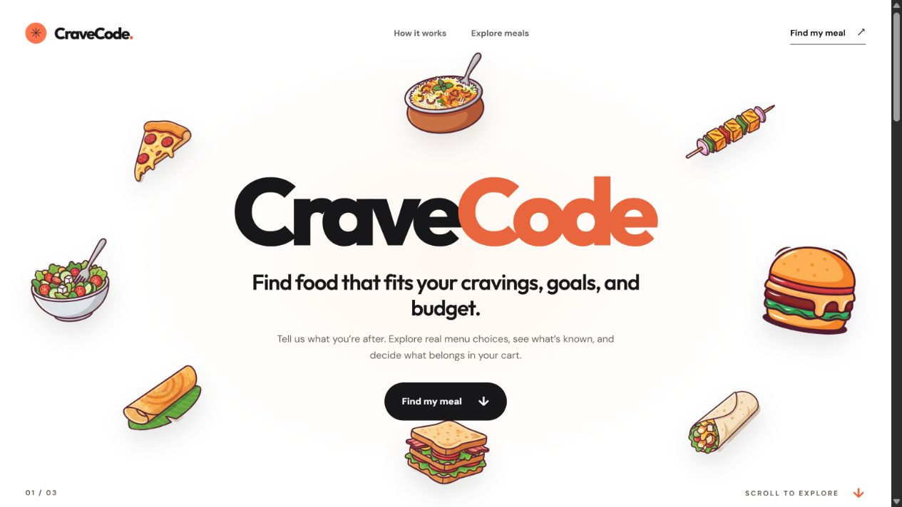

# CraveCode

CraveCode is a meal-discovery agent in progress. Give it a budget, diet, protein and calorie targets, and optional food preferences. The Phase 2 engine searches several goal-aware dish themes, ranks live Swiggy menu items locally, and explains what is and is not verified. It never places an order automatically.

The project is being built in [four phases](./FOUR_PHASE_ROADMAP.md). The [architecture](./ARCHITECTURE.md) and [frontend design](./FRONTEND_DESIGN.md) set the constraints for later work. **Phase 2's search workflow runs locally and on Render. Public search has a configured SerpApi key; public Swiggy OAuth still needs production approval. Nutrition-source matching and cart preparation remain open.**

The implemented frontend has a white hero with eight floating food illustrations, a black meal-brief section, and a white results area. A dish is optional. A signed-in local Swiggy search returns ranked live menu cards. The hosted site uses SerpApi for clearly labeled public web leads by city once configured; these are not verified deliverable menu items.



[Mobile hero](./docs/cravecode-mobile.png) · [Dark meal brief](./docs/cravecode-brief.png)

## Run locally

Requirements: Node.js 24+, npm, and optionally a local Ollama service with the small `gemma3:270m` model pulled.

```powershell
npm ci
Copy-Item .env.example .env
npm run build
npm start
```

Open `http://localhost:8787`. For live frontend changes, run `npm run dev:api` and `npm run dev` in separate terminals, then open `http://localhost:5173`. In that mode set `PUBLIC_ORIGIN=http://localhost:5173` in `.env` for the OAuth callback.

```powershell
npm run check
npm test
npm run gemma:probe
npm run gemma:evaluate
```

The Gemma probe uses the Ollama generate API by default. Set `GEMMA_API_URL` and `GEMMA_MODEL` to another compatible endpoint/model if needed. `gemma:evaluate` compares up to three constrained extra dish themes against the deterministic planner on a five-brief offline menu-name fixture; it is a proxy, not proof of live Swiggy coverage. The first search stays deterministic. A signed-in local visitor can request more dish ideas after seeing initial results; the UI reports the themes tried and how many genuinely new Swiggy menu items they found. If the model fails to return a usable suggestion, a diet- and goal-checked fallback supplies the extra themes and is labeled as such.

## Phase 2 search

The `/api/meal-search` endpoint validates the brief, runs a Mastra workflow (bounded query planning → discovery → evidence checks), and returns a versioned job result. Local authenticated Swiggy calls cover up to four dish themes and one additional menu page per theme when available, with deduplication, source timeouts, stock/diet filtering, and provisional ranking. The initial shortlist shows up to 15 items and spreads its first picks across restaurants when possible. A review preference uses both Swiggy rating and review count; area, distance, and delivery time are shown when returned. Low ratings, limited history, or unavailable data are labeled. Ratings are customer feedback, not food-safety certification. Public Render calls use one SerpApi Google search per click for the chosen city and link to source pages. Web leads have no claimed price, diet, stock, restaurant rating, nutrition, or deliverability. All-in budget and macro targets cannot be called exact matches without verified data. Search jobs/candidates are saved to Atlas when connected; a database write failure returns the results with a warning.

Sentry spans are enabled only when `SENTRY_DSN` is configured. Spans use stage names without address IDs, credentials, dish text, or full request bodies. Local Gemma is limited to choosing up to three extra dishes from a diet/goal-aware allowlist on explicit user action. It cannot replace the initial search, invent macros, or run on Render. The local shortlist may show broad, illustrative dish nutrition ranges from the [documented approximation method](./NUTRITION_METHOD.md). These are not measured restaurant servings and never qualify as an exact match. Exact restaurant-item nutrition matching remains open. The older on-demand generic nutrition API remains available for experiments but is not exposed in the UI and shares the strict SerpApi credit cap.

## Swiggy integration

Connecting Swiggy locally starts its documented OAuth 2.1/PKCE browser flow, which requires the account holder's phone/OTP. After connection, choose a saved address and search. The dish field is optional; the engine otherwise explores several candidates suggested by the goal and diet. The API returns only a small menu summary: name, restaurant, menu price, stock, and IDs. It does not claim the item meets macro or final-budget goals.

The experimental cart-probe endpoint asks for explicit confirmation, rechecks the item within its restaurant, refuses to overwrite a nonempty cart, and requires a read-back before claiming success. The account holder reports that the first cart test did not work, so the visible cart button is hidden while we build the search engine. We will diagnose the exact failure in Phase 3. No checkout or order tool is exposed. The local SDK can expose the current `update_food_cart` input schema at `/api/swiggy/cart-tool-schema` for debugging because Swiggy's recipe and reference examples use different cart payload shapes.

Swiggy OAuth is deliberately limited to localhost. Sessions and tokens are held in server memory and vanish on restart. Before a public multiuser release, move these into per-user encrypted storage, add proper session management, and complete Swiggy's production-access review. See the [Swiggy developer quickstart](https://mcp.swiggy.com/builders/docs/start/developer/) and [authentication guide](https://mcp.swiggy.com/builders/docs/start/authenticate/).

The local app now reuses the public OAuth client ID after a successful Swiggy registration, including across server restarts. It stores only the client ID and matching redirect URI in ignored `.swiggy-oauth-registration.json`; **user access tokens remain in memory**. This avoids registering a new client on every reconnect. If Swiggy rejects the first registration before phone sign-in, the form displays a clear error. That rejection must be resolved by Swiggy's registration service or developer access; the app cannot manufacture a client ID or skip OAuth. Avoid repeated connection attempts during a 429/rate limit and use [Swiggy Builders support](https://mcp.swiggy.com/builders/docs/operate/support/) if the rejection persists.

## Configuration

| Variable | Use |
| --- | --- |
| `PORT` | API and production-build port; default `8787`. |
| `PUBLIC_ORIGIN` | Optional browser origin override. Defaults to Render's `RENDER_EXTERNAL_URL` on Render, or `http://localhost:5173` locally. |
| `MONGODB_URI` | Optional Atlas connection. If absent, `/api/system` reports `not-configured`. |
| `MONGODB_DB` | Database name; default `mealpilot`. |
| `SERPAPI_API_KEY` | Server-side SerpApi key for public city-based web search. Do not put it in the frontend or Git. |
| `SENTRY_DSN` | Optional server-side tracing destination. |
| `GEMMA_API_URL` | Ollama-compatible `/api/generate` URL for the probe. |
| `GEMMA_MODEL` | Local model for optional extra dish exploration; `.env.example` suggests `gemma3:270m`. |
| `GEMMA_API_KEY` | Optional bearer token for a hosted compatible endpoint. |

The Atlas initializer creates indexes for `meal_jobs`, `candidates`, `nutrition_claims`, `cart_audits`, `preferences`, browser demo sessions, and SerpApi budgets. Search jobs and candidates are persisted when Atlas is configured. Server credentials never enter the browser bundle. The `render.yaml` provides a Singapore-region free web-service blueprint. Add `SERPAPI_API_KEY` and `MONGODB_URI` as Render environment secrets. Allow the service's outbound IP ranges in Atlas Network Access. Render supplies its own public origin. Swiggy OAuth remains disabled on Render until public access and per-user session storage are ready.

Each browser session gets five demo search submissions. Each public click now makes at most one uncached SerpApi search; search responses are cached in memory by query for one hour. A shared, server-side budget reserves at most five SerpApi calls per UTC day and 100 per UTC month across public visitors, including the experimental nutrition API. Render refuses paid calls if Atlas is unavailable, so a server restart cannot bypass the budget. A browser session cookie contains only a random ID, not credentials. This path is for discovery leads, not verified menu prices. Do not commit the API key or Atlas URI.

The live preview is [cravecode.onrender.com](https://cravecode.onrender.com/). The free service can sleep when idle, so allow time for its first request to wake it. Public web search will not return leads until `SERPAPI_API_KEY` is set in Render.

## What is real now

- Responsive three-scene CraveCode frontend with all eight user-supplied illustrations floating around the wordmark, a dark meal form, and a white results area.
- Accessible single-select diet/goal controls, optional dish, numeric units, validation, reduced-motion support, and an honest disconnected-results state.
- Typed meal, candidate, evidence, and cart-audit contracts.
- Node API serving the built frontend, validating briefs, running a Mastra search workflow, and providing local Swiggy OAuth/menu/cart integration paths.
- Connected Atlas search persistence and budget indexes, plus a local Gemma structured-output probe and extra-dish action.
- Authenticated local Swiggy address selection and menu search were observed with 10 real item cards before the Phase 2 changes. The owner signed in again and confirmed ranked live cards with the optional dish field empty. Atlas connection and saved search records were confirmed by the owner. The owner saw no safe new dish suggestion in the first Gemma pass, which prompted the bounded multi-theme fallback; the revised action still needs a signed-in browser check. Cart read-back remains unverified. No exact nutrition or all-in price claims.

See [PHASE1_STATUS.md](./PHASE1_STATUS.md) for the checks completed in this workspace and the external gates still open.
